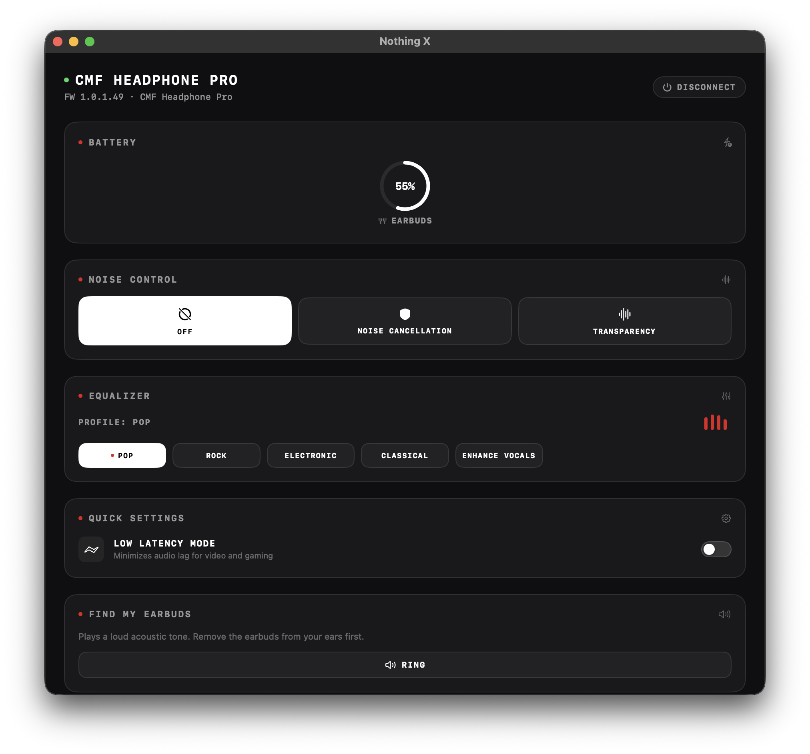

# Ear-Desk for macOS 🎧

A lightweight, native SwiftUI app designed specifically for macOS (Apple Silicon, macOS 13+) to monitor and manage your **Nothing** and **CMF by Nothing** earbuds without needing a phone.

Built with Nothing's signature dark aesthetic, featuring live battery rings, full Active Noise Cancellation (ANC) switching, Equalizer profiles, Ultra Bass / Bass Enhance toggles, Find My Earbuds, and a dynamic menu bar extra with a circular battery gauge.

<p align="center">
  
</p>

---

## ⚡ Features

- **Dynamic Menu Bar Item**:
  - Live circular battery progress ring rendered around the earbuds icon.
  - Throttled 5-minute background refresh to minimize Bluetooth polling and battery consumption.
  - Quick dropdown access to switch ANC modes or disconnect.
- **Nothing OS Dark Aesthetic**:
  - Obsidian surface styling, red accent indicators, and monospaced typography.
  - Animated live circular battery rings for Left, Right, Case, or Stereo channels with charging state indicators.
- **Noise Control**:
  - Switch between **Off**, **Noise Cancellation**, and **Transparency**.
  - Adjust NC strength levels: **High**, **Mid**, **Low**, and **Adaptive** (for supported models).
- **Equalizer**:
  - Supports both Classic 4-band presets (*Balanced*, *More Voice*, *More Treble*, *More Bass*) and 5/6-band Listening Mode presets (*Dirac OPTEO*, *Pop*, *Rock*, *Classical*, *Electronic*, *Enhance Vocals*).
  - Real-time animated frequency visualizer matching the active preset.
- **Bass Enhance / Ultra Bass**:
  - Multi-level intensity slider with segmented LED-style visual feedback.
- **Quick Settings**:
  - In-Ear Detection toggle (auto-pause).
  - Low Latency Mode toggle (gaming / video synchronization).
- **Find My Earbuds**:
  - Single-click acoustic locator tone for both earbuds.

---

## 🛠️ Supported Devices

Compatible with most Nothing and CMF audio devices communicating over Bluetooth Classic (RFCOMM):

- Nothing Ear (1)
- Nothing Ear (2)
- Nothing Ear (2024)
- Nothing Ear (a)
- Nothing Ear (open)
- Nothing Ear (Stick)
- CMF Buds / CMF Buds 2 / CMF Buds 2 Plus / CMF Buds 2a
- CMF Buds Pro / CMF Buds Pro 2
- Nothing Headphone (1) / Headphone (a) / CMF Headphone Pro

*Note: Device models are automatically identified using Bluetooth device names. If needed, a "Model Override" picker is provided in the connection screen.*

---

## 🚀 Building & Running

### Requirements
- macOS 13.0 (Ventura) or newer
- Apple Silicon Mac (`arm64`)
- Xcode 15+ or Swift 5.9+ Command Line Tools

### Build the `.app` bundle:
Clone the repository and run the build script:

```bash
git clone https://github.com/balshaansingh29/Ear-Desk-macOS.git
cd Ear-Desk-macOS
./build.sh
```

The script will:
1. Run the test suite (`swift test`).
2. Compile the release binary optimized for Apple Silicon.
3. Bundle the application into `build/Ear-Desk.app` with the high-resolution `AppIcon.icns`.
4. Ad-hoc codesign the application so macOS prompts for Bluetooth access upon first launch.

To open the app immediately:
```bash
open "build/Ear-Desk.app"
```
Or move it to your Applications folder:
```bash
cp -R "build/Ear-Desk.app" /Applications/
```

---

## 🙏 Credits & Acknowledgments

This project is built upon the protocol reverse-engineering work from:

* **[ear-web](https://github.com/radiance-project/ear-web)** by **[radiance-project](https://github.com/radiance-project)**:
  - Protocol specifications, packet framing, CRC16 algorithms, command opcodes, and device configurations were derived from `ear-web`.
  - While `ear-web` connects through Chrome's Web Serial API, **Ear-Desk** ports this architecture natively to macOS using Apple's `IOBluetooth` (SPP/RFCOMM) and SwiftUI.
  - Special thanks to the contributors of `ear-web` for documenting the Nothing earbud protocol.

---

## 📄 License & Disclaimer

- **License**: Licensed under the **GNU Affero General Public License v3.0 (AGPL-3.0)** as a derivative of [ear-web](https://github.com/radiance-project/ear-web). See [`LICENSE`](LICENSE) for complete details.
- **Disclaimer**: This is an independent, open-source community project and is **not** affiliated, associated, authorized, endorsed by, or in any way officially connected with **Nothing Technology Limited** or any of its subsidiaries or affiliates. "Nothing", "CMF", and related marks are trademarks of Nothing Technology Limited.
