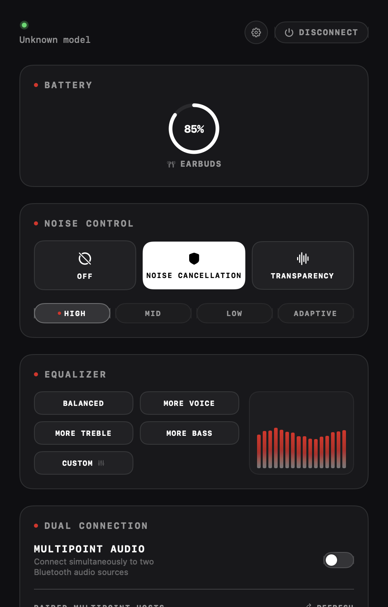

# 🎧 Ear-Desk for macOS ⚡

<p align="center">
  
</p>

<p align="center">
  <a href="https://github.com/balshaansingh29/Ear-Desk-macOS/releases/latest"></a>
  <a href="https://github.com/balshaansingh29/Ear-Desk-macOS/releases"></a>
  <a href="LICENSE"></a>
  <a href="https://developer.apple.com/macos/"></a>
</p>

<p align="center">
  <strong>Control your Nothing & CMF earbuds right from your Mac menu bar. No phone required. 🎛️</strong><br>
  <em>A sleek, native SwiftUI utility featuring real-time battery rings, Active Noise Cancellation (ANC), 16-band Equalizer spectrum, Ultra Bass, Multipoint Audio, and dynamic Liquid Glass icons.</em>
</p>

---

## 🌟 Overview

Tired of reaching for your phone just to tweak ANC or check battery levels while working on your Mac? **Ear-Desk** brings the complete **Nothing X app experience natively to macOS**.

Communicating directly over **Bluetooth Classic (RFCOMM)** with zero electron bloat, **Ear-Desk** gives you instantaneous control over your **Nothing Ear (1, 2, 2024, a, open, stick)** and **CMF by Nothing Buds / Headphones** without consuming system memory or draining battery.

---

## ⚡ Key Features

### 🔋 Dynamic Menu Bar Battery Gauge
- 🟢 **Live Circular Battery Ring**: Custom-drawn circular battery ring directly around your device's glyph in the menu bar.
- ⏱️ **Energy-Throttled Refresh**: Intelligent 5-minute background polling keeps battery stats accurate with near-zero power draw.
- 🖱️ **Instant Quick-Action Dropdown**: Toggle ANC modes, inspect earbud/case charge, or disconnect with a single click.

### 🔕 Active Noise Cancellation (ANC) & Transparency
- 🔇 **3 Core Modes**: Seamlessly switch between **Noise Cancellation**, **Transparency**, and **Off**.
- 🎚️ **Adaptive Intensity Levels**: Choose between **High**, **Mid**, **Low**, and **Adaptive** noise suppression on supported models.

### 🎼 16-Band Equalizer & Animated Spectrum Visualizer
- 📊 **Real-Time Spectrum Visualizer**: Animated harmonic audio wave reactive to the chosen preset.
- 🎛️ **Signature Presets**: *Balanced*, *More Voice*, *More Treble*, *More Bass*, *Dirac OPTEO*, *Pop*, *Rock*, *Classical*, *Electronic*, and *Enhance Vocals*.
- 🛠️ **Interactive Custom EQ Modal**: Adjust Bass (140 Hz), Mid (980 Hz), and Treble frequency decibels with instant hardware feedback.

### 🎧 Dual Connection & Multipoint Audio
- 📱💻 **Simultaneous Multi-Device Pairing**: Manage two audio sources (Mac, iPhone, Android, iPad) directly from the desktop.
- 🔀 **One-Click Handover**: Toggle connected hosts on the fly without unpairing.

### 🔊 Ultra Bass & Spatial Audio
- 💥 **Segmented Ultra Bass Slider**: Dial in real hardware bass enhancement levels (Level 1–5).
- 🌐 **Spatial Audio Simulation**: Choose between **Fixed**, **Head-Tracked**, **Concert**, and **Theatre** listening dimensions.

### 🧪 Flat Liquid Glass Dynamic App Icons
- 💎 **Adaptive macOS Icon Suite**: Handcrafted **Light**, **Dark**, **Clear Light**, **Clear Dark**, **Tinted Light**, and **Tinted Dark** icon styles.
- 🔄 **Real-Time System Matrix Sync**: Adapts automatically with macOS Sequoia system appearance mode changes with zero lag.

### 🚀 Additional Smart Tools
- ⚡ **Auto-Connect**: Detects when your earbuds pair to macOS and automatically initializes the control link.
- 🔔 **Low Battery Desktop Notifications**: Native alerts when battery level drops below 15%.
- 🎯 **Find My Earbuds**: Acoustic chirping alarm to quickly locate misplaced earbuds around your desk.
- 👂 **In-Ear Detection & Low Latency Game Mode**: One-tap toggles for smart auto-pause and ultra-low audio latency.

---

## 📱 Supported Devices

Ear-Desk automatically detects and displays authentic hardware renders for:

| 🏷️ Brand | 🎧 Supported Audio Models |
| :--- | :--- |
| **Nothing** | • **Nothing Ear (1)**<br>• **Nothing Ear (2)**<br>• **Nothing Ear (2024)**<br>• **Nothing Ear (a)**<br>• **Nothing Ear (open)**<br>• **Nothing Ear (stick)**<br>• **Nothing Headphone (1)** |
| **CMF by Nothing** | • **CMF Buds** / **CMF Buds 2** / **CMF Buds 2 Plus** / **CMF Buds 2a**<br>• **CMF Buds Pro** / **CMF Buds Pro 2**<br>• **CMF Headphone Pro**<br>• **CMF Neckband Pro**<br>• **CMF Clip Pro** |

*Hardware models are identified automatically via Bluetooth. A manual "Model Override" picker is also available.*

---

## 📦 Download & Installation

### Option 1: Drag-and-Drop DMG (Recommended) 💿
Download the latest pre-compiled installer from [GitHub Releases](https://github.com/balshaansingh29/Ear-Desk-macOS/releases/latest):

1. Download **[`Ear-Desk-macOS-v1.6.0.dmg`](https://github.com/balshaansingh29/Ear-Desk-macOS/releases/download/v1.6.0/Ear-Desk-macOS-v1.6.0.dmg)**.
2. Open the disk image and drag **`Ear-Desk.app`** into **`Applications`**.
3. Launch **Ear-Desk** and approve the Bluetooth permission request when prompted.

### Option 2: Portable ZIP Archive 📁
- Download **[`Ear-Desk-macOS-v1.6.0.zip`](https://github.com/balshaansingh29/Ear-Desk-macOS/releases/download/v1.6.0/Ear-Desk-macOS-v1.6.0.zip)**, unzip, and launch directly.

---

## 🛠️ Building from Source

### Prerequisites:
- 🍏 **macOS 13.0 (Ventura)** or newer
- 💻 **Apple Silicon Mac** (`arm64` — M1, M2, M3, M4)
- 🔨 **Xcode 15+** or **Swift 5.9+** Command Line Tools

```bash
# 1. Clone the repository
git clone https://github.com/balshaansingh29/Ear-Desk-macOS.git
cd Ear-Desk-macOS

# 2. Compile tests, release bundle, and DMG installer
./build.sh

# 3. Open the newly built app
open build/Ear-Desk.app
```

---

## 🤝 Credits & Acknowledgments

* **[ear-web](https://github.com/radiance-project/ear-web)** by **[radiance-project](https://github.com/radiance-project)**:
  - Huge credit to the authors of `ear-web` for their pioneering protocol reverse-engineering work, packet structures, and command opcode documentation.
  - While `ear-web` was built for Chrome's Web Serial API, **Ear-Desk** is a 100% native macOS implementation engineered in Swift, SwiftUI, and `IOBluetooth` (RFCOMM).

---

## 📄 License & Legal Notice

- ⚖️ **License**: Distributed under the **GNU Affero General Public License v3.0 (AGPL-3.0)** as a derivative of [ear-web](https://github.com/radiance-project/ear-web). See [`LICENSE`](LICENSE) for full details.
- 🛡️ **Trademark Disclaimer**: Ear-Desk is an independent open-source project and is **not** affiliated, sponsored, authorized, or officially endorsed by **Nothing Technology Limited**. *Nothing*, *CMF*, and related trademarks belong to their respective owners.
